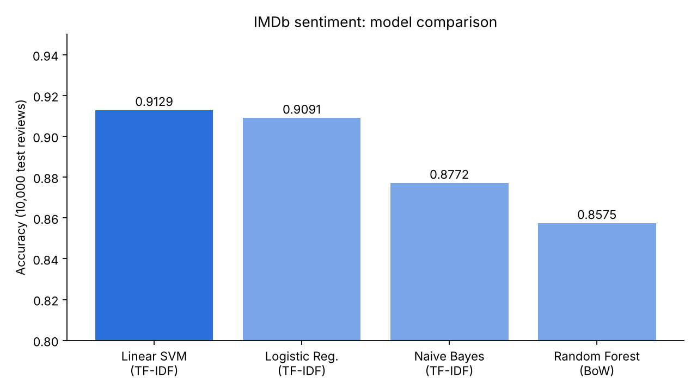
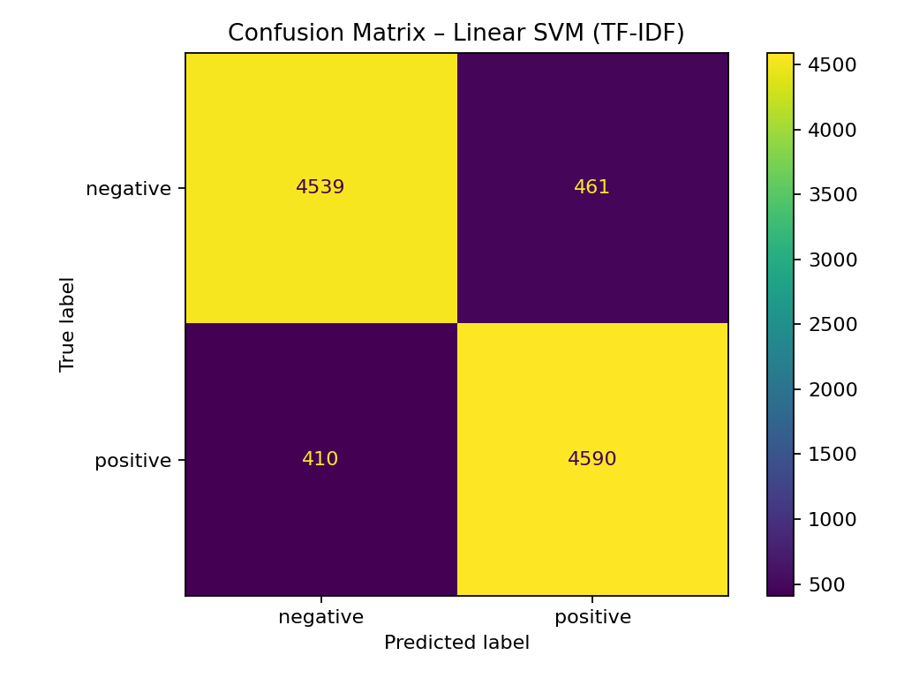
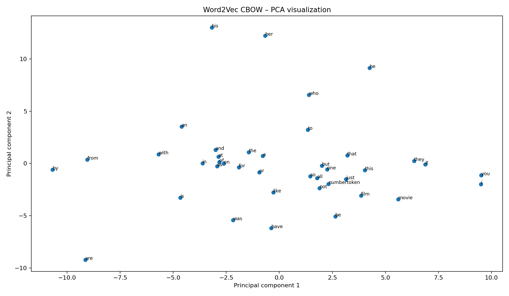
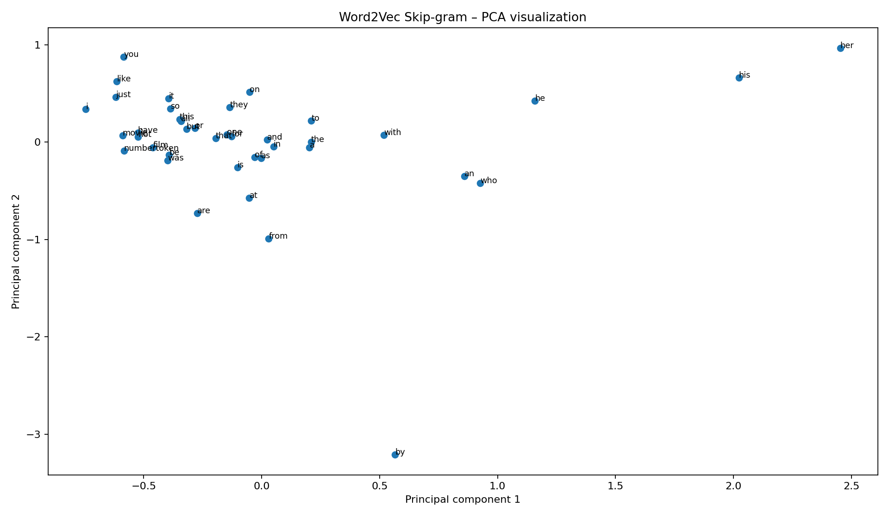
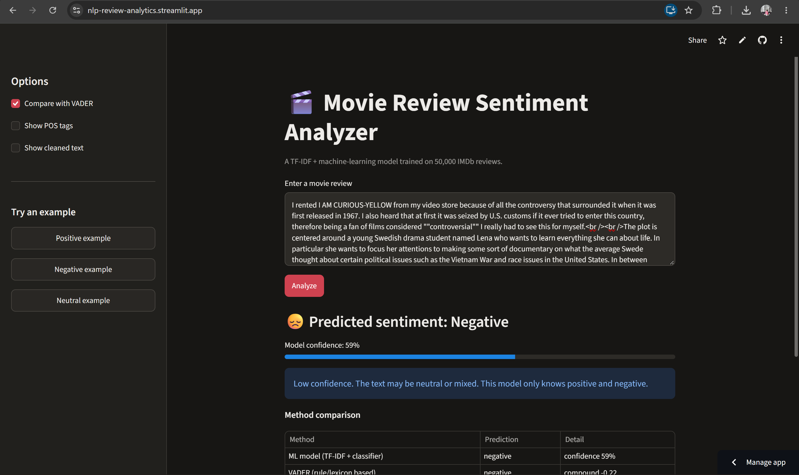

# Review Analytics: From Raw Text to Streamlit App

An end-to-end Natural Language Processing project that takes raw text through preprocessing, feature extraction, word embeddings, sentiment classification, and a deployed Streamlit web app. Built as a college practical project in a single Jupyter notebook.



## What this project covers

| Step | Topic | What is done |
|---|---|---|
| 1 | Fundamentals and preprocessing | Regular expressions, cleaning, tokenization, stopwords, stemming vs. lemmatization |
| 2 | Feature extraction | Bag of Words, TF-IDF, unigram and bigram features |
| 3 | Word embeddings | Word2Vec CBOW and Skip-gram, PCA visualization |
| 4 | Text classification | Four classifiers for IMDb sentiment, evaluated on a held-out test set |
| 5 | Different NLP approaches | Rule-based vs. VADER vs. ML model, POS tagging with NLTK |
| 6 | Deployment | Streamlit app for live predictions |
| 7 | Reflection | Comparison of methods and limitations (below) |

## Datasets

- **IMDb Movie Reviews:** 50,000 labelled reviews (25,000 positive, 25,000 negative), used for sentiment analysis and Word2Vec.
- **UCI SMS Spam Collection:** 5,572 messages labelled `ham` or `spam`, used as a separate corpus for feature-extraction practice. Spam is not a sentiment label.

The datasets are not stored in this repository. See [Setup](#setup).

## Results

Sentiment classification on IMDb, 80/20 stratified split (40,000 train / 10,000 test), `random_state=42`:

| Model | Accuracy | Precision | Recall | F1 (weighted) |
|---|---|---|---|---|
| **Linear SVM (TF-IDF, 1-2 grams)** | **0.9129** | 0.9129 | 0.9129 | 0.9129 |
| Logistic Regression (TF-IDF, 1-2 grams) | 0.9091 | 0.9092 | 0.9091 | 0.9091 |
| Naive Bayes (TF-IDF, 1-2 grams) | 0.8772 | 0.8774 | 0.8772 | 0.8772 |
| Random Forest (BoW, 1-2 grams) | 0.8575 | 0.8575 | 0.8575 | 0.8575 |

The best model, Linear SVM, is saved and used by the app.

### Confusion matrix (best model)



### Word2Vec (CBOW vs. Skip-gram)

Trained on a 5,000-review sample, 100 dimensions, window 5, 10 epochs. Plots show the 40 most frequent words projected with PCA.

| CBOW | Skip-gram |
|---|---|
|  |  |

Nearest neighbours of "movie" (observed output):

- **CBOW:** film, show, series, flick, picture, sequel, episode, documentary. These are mostly sensible synonyms and related media words.
- **Skip-gram:** film, congratulations, 'b', chore, buzz, flashdance, fyi, downer. Noisier, because a 5,000-review sample is small for rare-word-sensitive Skip-gram training.

### Comparing approaches on sample sentences

| Text | Rule-based | VADER | ML model |
|---|---|---|---|
| "I absolutely loved this movie. The acting was brilliant!" | positive | positive | positive |
| "This was a terrible experience and a waste of money." | negative | negative | negative |
| "The film was released yesterday." | neutral | neutral | negative |

The ML model is trained only on positive and negative reviews, so it cannot answer "neutral" and is forced to pick a side.

## Streamlit app



The app takes a review, predicts the sentiment, shows a confidence bar, and can optionally compare against VADER, show POS tags, and show the cleaned text. The confidence for the Linear SVM is derived from its decision margin (a sigmoid of the margin), so treat it as an approximate score, not a true probability.

## Project structure

```
NLP/
├── NLP_Review_Analytics.ipynb   # full notebook, Steps 0-7
├── app.py                       # Streamlit app
├── requirements.txt
├── README.md
├── data/                        # not committed (IMDB Dataset.csv, spam.csv)
├── models/                      # sentiment_pipeline.pkl, word2vec models
├── outputs/                     # plots and the model comparison CSV
└── docs/
    └── app_screenshot.png
```

## Setup

1. Clone the repository and install dependencies:

   ```
   pip install -r requirements.txt
   ```

2. Get the data and put both files in a `data/` folder:
   - `IMDB Dataset.csv`: Kaggle, "IMDB Dataset of 50K Movie Reviews". The notebook's first cell can also build it from the Hugging Face `stanfordnlp/imdb` dataset.
   - `spam.csv`: UCI SMS Spam Collection.

3. Open the notebook and choose **Restart Kernel and Run All Cells**. This trains the models and creates `models/sentiment_pipeline.pkl`.

## Run the app

```
python -m streamlit run app.py
```

Then open http://localhost:8501. If the `streamlit` command is not recognized on Windows, the `python -m` form above avoids the PATH problem.

## Limitations

- Binary labels only: the model has no neutral class, so factual or mixed text is forced into positive or negative.
- Trained on movie reviews, so accuracy on other domains (products, tweets, support tickets) will likely be lower.
- Bag-of-words style features ignore word order beyond bigrams, so sarcasm and long-range negation are often missed.
- Word2Vec was trained on a small sample, so its embeddings, especially Skip-gram, are noisy.

## Possible improvements

- Add a neutral class or a confidence threshold that returns "uncertain".
- Try pretrained embeddings or a transformer model and compare against the TF-IDF baseline.
- Tune hyperparameters with cross-validation instead of a single split.

## Tech stack

Python, pandas, NumPy, scikit-learn, NLTK, Gensim, VADER, Matplotlib, Streamlit.

## Author

Your name, your course, your college
